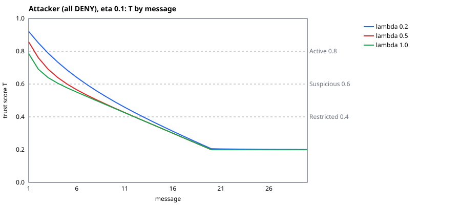
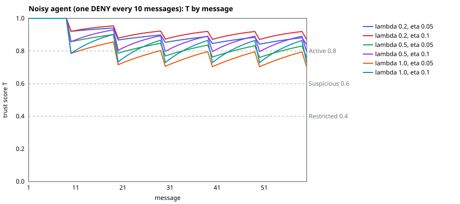

# Trust calibration (task A-R1)

A small experiment that chooses lambda and eta for the trust engine (A2) from
data instead of guessing them. Run from the repo root:

```
python -m runner --mode direct --llm fake --scenario N1 --scenario N2 --scenario N3 --scenario N4 --reps 3
python scripts/simulate_trust.py --sweep --events "results/<run_id>/events.jsonl"
```

Without `--events` the sweep uses a synthetic normal agent (see below), which is
what the test (`tests/test_broker/test_trust_calibration.py`) runs.

## Result

| Setting | Before | Chosen | Evidence |
|---|---|---|---|
| lambda (decay) | 0.5 | **0.5** | the lowest lambda in the grid that moves the attacker to Restricted within 5 messages (0.2 needs 7) |
| eta (recovery) | 0.05 | **0.1** | with lambda 0.5, the noisy agent spends 15 of 60 messages outside Active instead of 41 |
| weights, window, bands, hysteresis, severities | 0.20/0.50/0.30, 20, 0.80/0.60/0.40, 0.05 | unchanged | not in the A-R1 grid; still PROVISIONAL |

The chosen values are in `broker/trust/trust_settings.yaml`.

## Data

- **Normal agent:** run `20261125T193722Z` (direct mode, fake model, planner prompt v2,
  commit 74e71bf): N1 to N4, 3 reps each, 12 of 12 tasks completed. Its
  `events.jsonl` has 33 requests: planner 21 (`db.query_aggregate` 9,
  `research.lookup` 6, `tool.send_email_internal` 6), research 6
  (`file.read_internal` 3, `web.fetch_page` 3) and tool 6 (`mail.deliver` 6).
  Direct mode has no broker, so each request is replayed through the trust
  engine with the decision the broker would give an honest agent: ALLOW, or HITL
  for `tool.send_email_external` (none in these runs). Each agent's requests run
  through one engine in order, across all 12 tasks.
- **Synthetic normal agent** (used when no events file is given, and by the
  test): 60 ALLOW plus one HITL for external mail.
- **Noisy agent:** 60 messages on `db.query_aggregate`, ALLOW except one DENY at
  every 10th message (Amna, 25 Nov).
- **Attacker:** 30 DENY on `db.query_rows` (the A9 pattern), trust engine only.

## Selection rule (Amna, 25 Nov)

1. Normal agents never leave Active.
2. The attacker reaches Restricted within 5 messages. V1 (A3) quarantines it at
   the 5th DENY.
3. Among the values that pass, the noisy agent spends the fewest messages
   outside Active (then: shortest stretch outside Active, attacker drops faster,
   larger lambda).

The task plan's rule was "the attacker is quarantined within 5 messages". The
trust score alone cannot do that for any value in the grid: after 5 DENY the
behaviour part Ba is still 15/20, so T is at least 0.20 + 0.50 x 0.75 = 0.575
even if Ca falls to 0. Every lambda quarantines at message 13, when Ba drops
low enough. Quarantine within 5 is V1's job (A3, scenario A9).

## Grid results

Normal data from run `20261125T193722Z`:

| lambda | eta | normal lowest T | normal always Active | noisy lowest T | noisy msgs outside Active | noisy longest stretch | attacker Suspicious at | attacker Restricted at | attacker Quarantined at | passes |
|---|---|---|---|---|---|---|---|---|---|---|
| 0.2 | 0.05 | 1.0000 | yes | 0.8398 | 0 | 0 | 3 | 7 | 13 | no |
| 0.2 | 0.1 | 1.0000 | yes | 0.8704 | 0 | 0 | 3 | 7 | 13 | no |
| 0.5 | 0.05 | 1.0000 | yes | 0.7595 | 41 | 41 | 2 | 5 | 13 | yes |
| 0.5 | 0.1 (chosen) | 1.0000 | yes | 0.7957 | 15 | 5 | 2 | 5 | 13 | yes |
| 1.0 | 0.05 | 1.0000 | yes | 0.7032 | 50 | 41 | 1 | 5 | 13 | yes |
| 1.0 | 0.1 | 1.0000 | yes | 0.7288 | 37 | 8 | 1 | 5 | 13 | yes |

With the synthetic normal agent the table is the same except "normal lowest T"
is 0.9750 in every row (the one HITL); it stays Active for every value.





## Reading the results

- eta only matters for recovery, so it changes the noisy agent's numbers, not
  the attacker's.
- With lambda 0.5 and eta 0.05, a DENY every 10 messages keeps the noisy agent
  in Suspicious from message 20 to the end (41 messages): Ca has not recovered
  before the next DENY. eta 0.1 lets it climb back to Active (T at least 0.85)
  between most denials; its longest stretch outside Active is 5 messages.
- lambda 1.0 moves the attacker to Suspicious at its first DENY, but also keeps
  the noisy agent out of Active for longer (37 or 50 messages).
- After a release (A3), the agent still reaches Suspicious after 6 clean
  messages and Active after 14 with eta 0.1 (the A2 tests still pass unchanged
  on those numbers).

## Limits

- The normal data is small (33 requests) and comes from the fake model, so it
  has little variety and no HITL, SANITIZE or injection cue. With it, every row
  keeps normal agents at T = 1.0, so rule 1 does not separate the values here.
  Live-model runs and Afaq's broker-mode runs (F5) would give a stronger test.
- Only lambda and eta were varied. The weights and the window decide how fast
  trust alone can quarantine; changing them is a bigger change (FYP-II, or a
  second A-R1 round if the team wants trust to quarantine sooner on its own).
- The noisy pattern is one fixed rhythm (one DENY every 10 messages).
